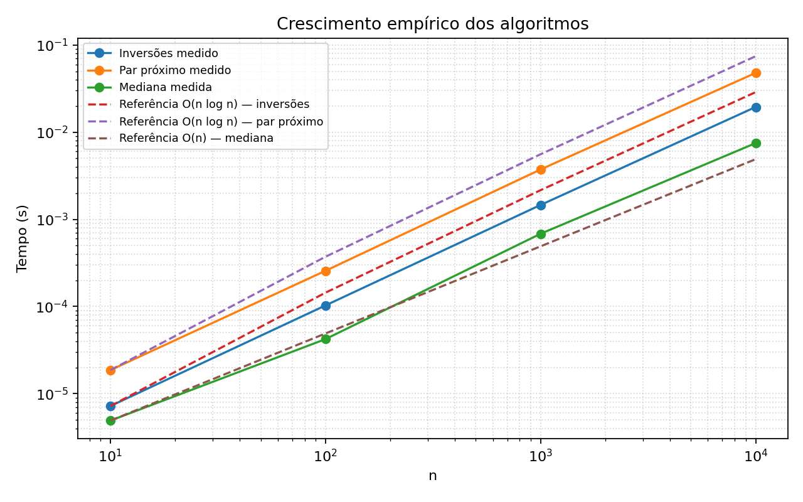

# Sistema de Recomendação para Streaming de Música

## Introdução

Projeto da disciplina de Projeto e Análise de Algoritmos (UnB). Sistema simplificado para um serviço de streaming de música, que integra três algoritmos de dividir e conquistar (Contagem de Inversões, Par de Pontos Mais Próximo e Mediana das Medianas) para recomendar usuários e músicas parecidos e entender o comportamento típico de escuta.

## Dupla

| Nome | Matrícula |
|---|---|
| Maria Clara Oleari de Araujo | 221008338 |
| Ana Júlia Mendes Santos | 221007798 |

## Problema

Serviços de streaming guardam muita informação sobre músicas e ouvintes: o que cada usuário prefere, como cada faixa soa e quantas vezes ela foi tocada. O sistema usa esses dados para responder, rápido e com milhares de itens, três perguntas, cada uma resolvida por um algoritmo:

```
1. Quais usuários têm gosto parecido?        → INVERSÕES
2. Quais músicas são mais parecidas?         → PAR DE PONTOS MAIS PRÓXIMO
3. Qual é a duração e o play típico?         → MEDIANA DAS MEDIANAS
```

Fluxo do sistema:

```
Usuários → INVERSÕES → usuários mais parecidos
Músicas  → PAR MAIS PRÓXIMO → músicas mais parecidas
Músicas  → MEDIANA DAS MEDIANAS → duração e plays típicos
```

O resultado final apresenta **os usuários mais parecidos, as músicas mais parecidas e a duração e os plays típicos**.

## Objetivo

- Implementar e testar os três algoritmos de dividir e conquistar, cada um com uma única implementação.
- Mostrar, para cada um, a estratégia, a recorrência e as complexidades de tempo e espaço.
- Integrar os três num fluxo único sobre dados de streaming gerados com semente fixa.
- Medir os tempos para n = 10, 100, 1.000 e 10.000 e comparar o crescimento medido com a teoria.

## Entrada

Os dados são gerados por [src/dados.py](src/dados.py), com semente fixa (42), então qualquer execução produz os mesmos dados. Os tamanhos são n = 10, 100, 1.000 e 10.000.

| Entidade | Campos |
|---|---|
| **Música** | `id`, `nome`, `energia` (0 a 1), `dancabilidade` (0 a 1), `duracao` (segundos), `plays` |
| **Usuário** | `id`, `ranking`: permutação dos ids das n músicas, da preferida para a menos preferida |

Cada algoritmo recebe:

| Algoritmo | Entrada |
|---|---|
| Inversões | Dois rankings de usuários (listas de ids de músicas) |
| Par mais próximo | Lista de músicas, usando `(energia, dancabilidade)` como ponto |
| Mediana das medianas | Lista de durações ou de plays, mais `k` ou `p` |

`python src/dados.py` grava os dados em `data/musicas_n{n}.csv` e `data/usuarios_n{n}.csv`. As assinaturas das funções estão em [docs/assinaturas.md](docs/assinaturas.md).

## Algoritmos usados e por quê

| Etapa | Algoritmo | Estratégia | Por que é adequado |
|---|---|---|---|
| Similaridade entre usuários | Contagem de inversões | Dividir e conquistar (Sort-and-Count) | Comparar dois rankings é contar os pares em ordem oposta; o merge ordena e conta ao mesmo tempo, em O(n log n) em vez de O(n²) |
| Músicas mais parecidas | Par de pontos mais próximo | Dividir e conquistar (divisão por x + faixa de 2δ) | Cada música é um ponto (energia, dançabilidade); só é preciso comparar pontos próximos da linha de divisão, em O(n log n) em vez de O(n²) |
| Valores típicos | Mediana das medianas | Dividir e conquistar (select com grupos de 5) | Acha a mediana em O(n) sem ordenar, e a mediana é robusta a outliers (a média não é) |

### Complexidades resumidas

| Algoritmo | Recorrência | Tempo | Espaço |
|---|---|---|---|
| Inversões | T(n) = 2T(n/2) + O(n) | `O(n log n)` | `O(n)` |
| Par mais próximo | T(n) = 2T(n/2) + O(n) | `O(n log n)` | `O(n)` |
| Mediana das medianas | T(n) = T(n/5) + T(7n/10) + O(n) | `O(n)` | `O(n)` |

Onde `n` é o número de elementos (rankings, músicas ou valores).

## Saída

O fluxo completo mostra no terminal os dois usuários mais parecidos e a similaridade entre eles (0 = rankings idênticos, 1 = invertidos), o par de músicas mais parecidas e a distância entre elas, e a mediana e alguns percentis de duração e de plays.

## Análise dos algoritmos

### Inversões (similaridade entre usuários)

- **Problema:** dados dois rankings de músicas feitos por usuários diferentes, medir o quanto eles discordam. Contar os pares de músicas que aparecem em ordem oposta nos dois rankings (distância de Kendall tau). Reescrevendo o ranking A com a posição de cada música no ranking B, isso vira contar as inversões de uma sequência: pares `i < j` com `a[i] > a[j]`.
- **Estratégia (Sort-and-Count):**
  - **Dividir:** separar a lista em duas metades.
  - **Conquistar:** contar recursivamente as inversões de cada metade, que volta ordenada.
  - **Combinar:** fazer o merge das duas metades ordenadas. Cada vez que um elemento da direita é escolhido antes de elementos que ainda restam na esquerda, ele forma inversão com todos eles. Basta somar `len(esquerda) - i`.
- **Por que O(n log n):** o merge ordena e conta ao mesmo tempo, então cada nível da recursão custa O(n). A versão que reordena a lista a cada nível custaria O(n log² n), e por isso não foi usada.
- **Recorrência:** T(n) = 2T(n/2) + O(n), que resolve para **O(n log n)** no tempo (Teorema Mestre, caso 2).
- **Espaço:** O(n), pelas listas auxiliares do merge, mais a pilha de recursão de profundidade O(log n).
- **Similaridade:** `similaridade(a, b)` divide o número de inversões por n(n-1)/2, o máximo possível. Dá 0 para rankings idênticos e 1 para rankings invertidos.
- **Testes:** lista ordenada (0 inversões), lista invertida (n(n-1)/2), exemplo do slide `1 5 4 8 10 2 6 9 12 11 3 7` (22), lista vazia e com um elemento (0), valores repetidos e propriedades da similaridade.

### Par de pontos mais próximo (músicas parecidas)

- **Problema:** encontrar as duas músicas mais próximas no plano `(energia, dançabilidade)`, usando distância euclidiana.
- **Estratégia:** os pontos são ordenados por x uma vez. Cada chamada divide a lista ao meio, resolve as metades e devolve também seus pontos ordenados por y. O merge por y custa O(n). Depois, a combinação examina a faixa de largura `2δ` ao redor da divisão, onde `δ` é a menor distância encontrada nas metades.
- **Por que 7 vizinhos bastam:** divida a faixa em caixas de lado `δ/2`. Se existissem dois pontos da mesma metade na mesma caixa, a distância entre eles seria menor que `δ`. Logo cada caixa contém no máximo um ponto de cada metade. Na ordenação por y, qualquer candidato a distância menor que `δ` aparece entre os próximos 7 pontos; os demais já têm separação vertical de pelo menos `δ`.
- **Recorrência:** T(n) = 2T(n/2) + O(n), pois cada nível faz dois subproblemas de metade do tamanho, um merge por y e uma varredura linear da faixa. Pelo Teorema Mestre, T(n) = **O(n log n)**.
- **Espaço:** O(n) nas listas auxiliares e O(log n) na pilha recursiva.
- **Testes:** dois e três pontos, linha reta, duplicatas com distância zero, par cruzando a divisão, músicas e entrada com menos de dois pontos.

### Mediana das medianas (duração e plays típicos)

- **Problema:** achar a duração e o número de plays típicos das músicas. A média não serve: uma única música viral com milhões de plays puxa a média para cima. A mediana (o valor do meio) é robusta a esses outliers. Ordenar tudo para achá-la custa O(n log n), mas o algoritmo de seleção acha o k-ésimo menor valor em **O(n)**.
- **Estratégia (select com grupos de 5):** para achar o k-ésimo menor valor de uma lista:
  1. **Dividir** a lista em grupos de 5 elementos.
  2. Tirar a **mediana de cada grupo** (custo constante por grupo, O(n) no total).
  3. Achar, recursivamente, a **mediana dessas medianas**. Ela é o pivô.
  4. **Particionar** a lista em L (menores que o pivô), os iguais ao pivô e R (maiores).
  5. **Descer só no lado certo**: se k cai em L, repetir em L; se cai nos iguais, o pivô é a resposta; senão, repetir em R com k ajustado.

  Os valores iguais ao pivô são tratados à parte, para a recursão sempre progredir mesmo com muitas repetições.
- **Por que o pivô é bom (entre 3n/10 e 7n/10):** há n/5 grupos, e o pivô é a mediana das medianas, então metade dos grupos (n/10 grupos) tem a mediana menor ou igual ao pivô. Em cada um desses grupos, 3 dos 5 elementos (a mediana e os 2 menores que ela) são menores ou iguais ao pivô. Logo pelo menos 3 · n/10 = 3n/10 elementos são ≤ pivô. Pelo mesmo argumento no sentido contrário, pelo menos 3n/10 são ≥ pivô. Isso significa que L e R têm no máximo 7n/10 elementos cada, então a recursão do passo 5 nunca fica com mais de 7n/10 da lista.
- **Recorrência:** T(n) ≤ T(n/5) + T(7n/10) + O(n).
  - T(n/5): achar a mediana das medianas (passo 3).
  - T(7n/10): descer no lado maior da partição (passo 5).
  - O(n): montar os grupos, as medianas e a partição.

  Como n/5 + 7n/10 = 9n/10 < n, a soma dos tamanhos dos subproblemas é uma fração fixa de n. Os custos por nível formam uma série geométrica de razão 9/10, que soma no máximo 10 · cn, então T(n) = **O(n)**.
- **Por que grupos de 3 não dão linear:** com grupos de 3 o argumento de contagem dá apenas n/3 grupos, e cada grupo "bom" contribui com 2 de 3 elementos: pelo menos 2 · n/6 = n/3 elementos de cada lado, ou seja, a partição pode ficar em até 2n/3. A recorrência vira T(n) ≤ T(n/3) + T(2n/3) + O(n). Aqui n/3 + 2n/3 = n: os subproblemas somam o tamanho original e cada nível da recursão ainda custa O(n), com O(log n) níveis. O resultado é O(n log n), igual a ordenar. Com grupos de 5, a soma 9n/10 < n é o que faz a série convergir e dá o tempo linear.
- **Espaço:** O(n), pelas listas L, R e as medianas dos grupos, mais a pilha de recursão de profundidade O(log n).
- **Funções:**
  - `selecionar(valores, k)`: k-ésimo menor valor (k começa em 0).
  - `mediana(valores)`: valor do meio, ou média dos dois do meio se n é par.
  - `percentil(valores, p)`: percentil p (0 a 100) com interpolação linear, igual a `numpy.percentile`. Sendo assim, `percentil(v, 50) == mediana(v)`.

  Elas são aplicadas à duração e aos plays das músicas.
- **Testes:** resultado igual a `sorted(x)[k]` em entradas aleatórias (a ordenação é usada só como conferência dentro do teste), tamanho par e ímpar, valores repetidos, lista com um elemento, entrada já ordenada, uma lista com outlier extremo (a mediana quase não muda e a média dispara), erros para `k` fora do intervalo e lista vazia, e percentis conferidos contra `numpy.percentile`.

## Resultados experimentais

Cada valor é a mediana de cinco execuções. A criação das entradas fica fora da medição. Os dados brutos estão em [data/resultados_benchmark.csv](data/resultados_benchmark.csv).

| n | Inversões (s) | Par próximo (s) | Mediana (s) |
|---:|---:|---:|---:|
| 10 | 0,000007 | 0,000019 | 0,000005 |
| 100 | 0,000103 | 0,000257 | 0,000042 |
| 1.000 | 0,001462 | 0,003731 | 0,000683 |
| 10.000 | 0,019449 | 0,047901 | 0,007492 |



Entre 1.000 e 10.000 elementos, os tempos cresceram aproximadamente 13,3 vezes para inversões, 12,9 vezes para par próximo e 11,0 vezes para mediana. Ao multiplicar n por 10, as referências crescem 13,3 vezes para O(n log n) e 10 vezes para O(n). Os dados seguem a tendência teórica; diferenças pequenas vêm do custo fixo, do sistema operacional e da resolução do relógio. Tempos absolutos variam entre máquinas.

## Conclusão

Os três algoritmos resolvem etapas diferentes do mesmo fluxo sem recorrer a versões ingênuas. A contagem de inversões compara rankings e o par mais próximo compara características musicais em O(n log n). A mediana das medianas encontra valores típicos em O(n) no pior caso e resiste a músicas virais que distorceriam a média. Os testes cobrem casos-limite e os resultados experimentais acompanham as complexidades previstas.

## Exemplo de execução

Executando `python src/main.py` com a semente padrão:

```text
=== Sistema de Recomendação para Streaming de Música ===

1. Carregamento de dados (semente fixa): 1000 músicas e 5 usuários

2. Usuários mais parecidos — contagem de inversões
   Usuários 2 e 4: distância normalizada = 0.4739

3. Músicas mais parecidas — par de pontos mais próximo
   Musica 368 e Musica 402: distância = 0.000872

4. Valores típicos — mediana das medianas
   Duração: mediana = 345.5 s; P25 = 200.0 s; P75 = 474.0 s
   Plays: mediana = 3318.0; P25 = 881.2; P75 = 12400.5
```

## Estrutura do repositório

```
G1_Dividir-e-Conquistar_PA-26.2/
├── src/
│   ├── main.py          # fluxo completo: usuários -> inversões, músicas -> par próximo e mediana
│   ├── dados.py         # tipos (Musica, Usuario) e gerador de dados com semente fixa
│   ├── inversoes.py     # Contagem de inversões (Sort-and-Count) + similaridade
│   ├── par_proximo.py   # Par de pontos mais próximo
│   ├── mediana.py       # Mediana das medianas (select) + mediana e percentil
│   └── benchmark.py     # experimentos de tempo (n = 10, 100, 1.000, 10.000)
├── data/
│   ├── musicas_n{n}.csv, usuarios_n{n}.csv  # dados gerados por src/dados.py (não versionados)
│   ├── resultados_benchmark.csv             # dados brutos do benchmark
│   └── resultados_benchmark.png             # gráfico log-log
├── tests/
│   ├── test_dados.py
│   ├── test_inversoes.py
│   ├── test_par_proximo.py
│   └── test_mediana.py
├── docs/
│   ├── assinaturas.md
│   └── plano-de-commits-paa-dividir-e-conquistar.md  # plano de commits
├── pytest.ini
├── requirements.txt
├── LICENSE
└── README.md
```

## Como instalar

```bash
cd G1_Dividir-e-Conquistar_PA-26.2
python -m venv venv
venv\Scripts\activate        # Linux/macOS: source venv/bin/activate
pip install -r requirements.txt
```

## Como rodar

Gerar os dados (n = 10, 100, 1.000 e 10.000, em `data/`):

```bash
python src/dados.py
```

Fluxo completo: acha os usuários mais parecidos, as músicas mais parecidas e a duração e os plays típicos, e imprime o resultado no terminal:

```bash
python src/main.py
```

Benchmark: mede o tempo de cada algoritmo para n = 10, 100, 1.000 e 10.000, salva a tabela em `data/resultados_benchmark.csv` e o gráfico em `data/resultados_benchmark.png`:

```bash
python src/benchmark.py
```

## Como rodar os testes

```bash
python -m pytest -q
```

## Cronograma

O plano de commits detalhado está em [docs/plano-de-commits-paa-dividir-e-conquistar.md](docs/plano-de-commits-paa-dividir-e-conquistar.md).

## Relatório e vídeo de apresentação

- Assinaturas das funções: [docs/assinaturas.md](docs/assinaturas.md)
- Análise de cada algoritmo (estratégia, recorrência, complexidade) e resultados experimentais: seções "Análise dos algoritmos" e "Resultados experimentais" deste README
- Vídeo de apresentação: [https://youtu.be/MB-aw0wq7wc](https://youtu.be/MB-aw0wq7wc)

### Nota sobre o histórico de commits

Não foi possível manter o planejamento de commits graduais porque uma das integrantes precisou viajar para participar das eleições e, durante esse período, foi internada devido a complicações de saúde. Por precaução, ela permaneceu com a mãe, que poderia prestar apoio caso seu estado apresentasse alguma piora. 

## Checklist final

- [x] Dependências declaradas em `requirements.txt`
- [x] Suíte completa aprovada com `python -m pytest -q`
- [x] `python src/main.py` roda do zero
- [x] `python src/benchmark.py` gera CSV e gráfico
- [x] README contém estratégia, recorrência, tempo e espaço dos três algoritmos
- [x] README contém entrada, saída, conclusão e exemplo real
- [x] Repositório público e histórico das duas autoras conferidos
- [x] Vídeo publicado e referenciado no README
